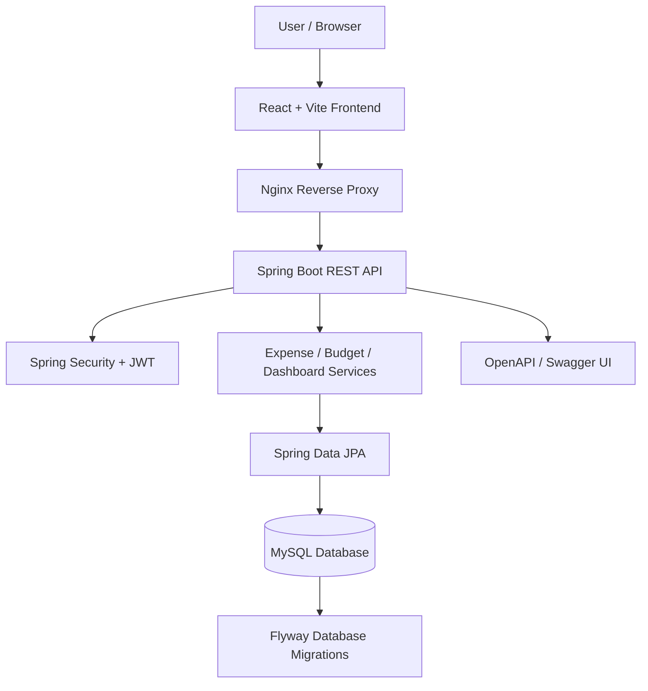
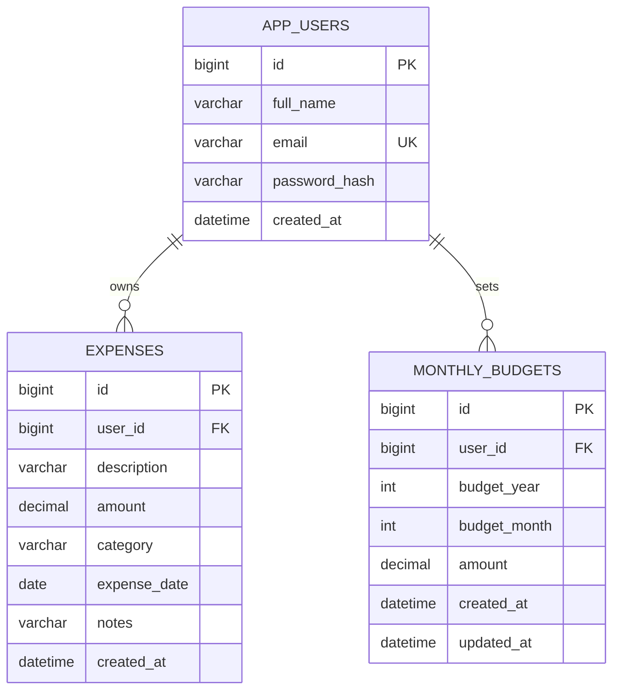

<div align="center">

# SpendWise
### Smart Expense & Financial Management System

A full-stack personal finance application to track expenses, manage monthly budgets, and understand spending patterns.

**Java 21 · Spring Boot · Spring Security · JWT · React · MySQL · Docker**

</div>

---

## Overview

SpendWise helps users record everyday expenses, organize transactions by category, set monthly spending targets, and review a financial summary from one dashboard.

The application uses a React frontend, a Spring Boot REST API, MySQL persistence, and stateless JWT authentication. It is packaged with Docker Compose so the full stack—including MySQL—can be started with one command.

## Features

### Authentication and account security
- User registration and login.
- Password hashing with BCrypt.
- Signed JWT access tokens.
- Stateless Spring Security resource-server authentication.
- Each user's expenses and budgets are isolated by authenticated user ID.

### Expense management
- Create, view, update, and delete expenses.
- Store amount, description, date, category, and optional notes.
- Filter transactions by date range and category.
- Categories: Food & Dining, Transport, Shopping, Bills & Utilities, Health, Entertainment, Education, Travel, and Other.

### Budget management
- Create or update a monthly spending limit.
- See amount spent, remaining amount, and percentage used.
- Keep separate budgets for each month and year.

### Dashboard and spending insights
- Monthly spending total and transaction count.
- Budget remaining and budget progress.
- Spending by category.
- Daily spending chart.
- Comparison with the previous month.
- Rule-based insights for budget status and highest-spending category.
- Recent transactions.

### Engineering and deployment
- REST API with request validation.
- Centralized API error responses.
- MySQL schema versioning with Flyway.
- OpenAPI / Swagger UI documentation.
- Dockerfiles for frontend and backend.
- Docker Compose orchestration with a persistent MySQL volume.
- GitHub Actions build workflow.

---

## Screenshots

Add your own screenshots after running the application:

```text
docs/
├── dashboard.png
├── transactions.png
└── budget-management.png
```

Then reference them here, for example:

```markdown

```

---

## Architecture



### Request flow

1. A user registers or logs in through the React interface.
2. Spring Boot validates credentials and returns a signed JWT.
3. The frontend sends the JWT in the `Authorization: Bearer` header.
4. Spring Security validates the token before a protected API request is handled.
5. Service-layer code scopes database queries to the authenticated user.
6. Dashboard APIs aggregate expenses and budgets for the selected month.
7. React displays the returned summaries and charts.

---

## Technology stack

| Layer | Technology |
|---|---|
| Language | Java 21 |
| Backend framework | Spring Boot 3.5.16 |
| REST APIs | Spring Web |
| Persistence | Spring Data JPA / Hibernate |
| Security | Spring Security, OAuth2 Resource Server, JWT |
| Password hashing | BCrypt |
| Validation | Jakarta Bean Validation |
| Database | MySQL 8.4 |
| Database migrations | Flyway |
| API documentation | Springdoc OpenAPI / Swagger UI |
| Frontend | React 19.3 |
| Build tool | Vite 8 |
| HTTP client | Axios |
| Charts | Recharts |
| Icons | Lucide React |
| Web server / proxy | Nginx |
| Containers | Docker, Docker Compose |
| CI | GitHub Actions |

---

## Project structure

```text
smart-expense-finance-system/
├── backend/
│   ├── src/main/java/com/spendwise/
│   │   ├── auth/                 # Register, login, profile and JWT issuance
│   │   ├── budget/               # Monthly budget APIs and persistence
│   │   ├── common/               # Global API exception handler
│   │   ├── config/               # Security, CORS and JWT configuration
│   │   ├── dashboard/            # Monthly summaries and insights
│   │   ├── expense/              # Expense CRUD, categories and DTOs
│   │   ├── user/                 # User entity and repository
│   │   └── SpendWiseApplication.java
│   ├── src/main/resources/
│   │   ├── db/migration/         # Flyway SQL migrations
│   │   └── application.properties
│   ├── Dockerfile
│   └── pom.xml
├── frontend/
│   ├── src/
│   │   ├── App.jsx
│   │   ├── api.js
│   │   ├── main.jsx
│   │   └── styles.css
│   ├── Dockerfile
│   ├── nginx.conf
│   ├── package.json
│   └── vite.config.js
├── .github/workflows/ci.yml
├── .env.example
├── .gitignore
├── docker-compose.yml
└── README.md
```

---

## Run locally with Docker (recommended)

### Prerequisites

Install:
- Docker Desktop (Windows / macOS) or Docker Engine + Compose plugin (Linux).
- Git, if cloning the repository.

You do **not** need to install MySQL, Maven, or Node.js locally when using Docker Compose.

### 1. Clone the repository

```bash
git clone https://github.com/rixshavv/MindFullSpend.git
cd smart-expense-finance-system
```

### 2. Create your environment file

Windows PowerShell:

```powershell
Copy-Item .env.example .env
```

macOS / Linux:

```bash
cp .env.example .env
```

Edit `.env` and replace the database passwords. Generate a strong JWT secret:

```bash
node -e "console.log(require('crypto').randomBytes(32).toString('base64'))"
```

Copy the generated value into `JWT_SECRET` in `.env`. Never commit `.env` to Git.

### 3. Start the full stack

```bash
docker compose up --build
```

The first build downloads base images and dependencies, so it may take a few minutes.

### 4. Open the application

| Service | URL |
|---|---|
| SpendWise frontend | http://localhost:8081 |
| Backend health | http://localhost:8081/actuator/health |
| API documentation | http://localhost:8081/swagger-ui/index.html |
| Backend (direct) | http://localhost:8080 |

Register a new user in the UI, then add expenses and set a monthly budget.

### 5. Stop the application

```bash
docker compose down
```

To remove the MySQL volume and all stored application data as well:

```bash
docker compose down -v
```

**Warning:** `-v` permanently deletes the local MySQL data volume.

---

## Run without Docker

If you prefer to run each component directly, install Java 21, Maven, Node.js 22.12+, and MySQL 8.4.

### 1. Create the MySQL database and application user

Log in to MySQL and run:

```sql
CREATE DATABASE smart_expense;

CREATE USER 'smart_app'@'localhost' IDENTIFIED BY 'replace_this_password';

GRANT ALL PRIVILEGES ON smart_expense.* TO 'smart_app'@'localhost';

FLUSH PRIVILEGES;
```

### 2. Configure backend environment variables

PowerShell example:

```powershell
$env:DB_URL="jdbc:mysql://localhost:3306/smart_expense?useSSL=false&allowPublicKeyRetrieval=true&serverTimezone=UTC"
$env:DB_USERNAME="smart_app"
$env:DB_PASSWORD="replace_this_password"
$env:JWT_SECRET="YOUR_BASE64_ENCODED_32_BYTE_SECRET"
$env:CORS_ALLOWED_ORIGINS="http://localhost:5173"
```

### 3. Start Spring Boot

```bash
cd backend
mvn spring-boot:run
```

Flyway applies the initial schema migration automatically. The API listens on port `8080`.

### 4. Start React

In another terminal:

```bash
cd frontend
npm install
npm run dev
```

Open http://localhost:5173. Vite proxies `/api` and `/actuator` requests to the backend at port `8080`.

---

## REST API reference

Base path: `/api`

Protected endpoints require:

```http
Authorization: Bearer <access-token>
```

### Authentication

| Method | Endpoint | Authentication | Description |
|---|---|---|---|
| POST | `/api/auth/register` | Public | Create an account |
| POST | `/api/auth/login` | Public | Authenticate and receive JWT |
| GET | `/api/auth/me` | Required | Get current user profile |

Register request:

```json
{
  "fullName": "Alex Morgan",
  "email": "alex@example.com",
  "password": "StrongPassword123"
}
```

Login request:

```json
{
  "email": "alex@example.com",
  "password": "StrongPassword123"
}
```

Authentication response:

```json
{
  "accessToken": "<signed-jwt>",
  "tokenType": "Bearer",
  "expiresInSeconds": 86400,
  "user": {
    "id": 1,
    "fullName": "Alex Morgan",
    "email": "alex@example.com"
  }
}
```

### Expenses

| Method | Endpoint | Description |
|---|---|---|
| GET | `/api/expenses?from=2026-11-01&to=2026-11-30` | List expenses in a date range |
| GET | `/api/expenses?from=2026-11-01&to=2026-11-30&category=FOOD_DINING` | Filter by category |
| POST | `/api/expenses` | Create an expense |
| PUT | `/api/expenses/{id}` | Update an expense |
| DELETE | `/api/expenses/{id}` | Delete an expense |

Create expense request:

```json
{
  "description": "Monthly groceries",
  "amount": 2450.50,
  "category": "FOOD_DINING",
  "date": "2026-11-01",
  "notes": "Weekly grocery purchase"
}
```

Supported category values:

```text
FOOD_DINING
TRANSPORT
SHOPPING
BILLS_UTILITIES
HEALTH
ENTERTAINMENT
EDUCATION
TRAVEL
OTHER
```

### Monthly budgets

| Method | Endpoint | Description |
|---|---|---|
| GET | `/api/budgets?year=2026&month=11` | Get a month's budget |
| PUT | `/api/budgets` | Create or update a month's budget |

Budget request:

```json
{
  "year": 2026,
  "month": 11,
  "amount": 30000
}
```

### Dashboard

| Method | Endpoint | Description |
|---|---|---|
| GET | `/api/dashboard?year=2026&month=11` | Monthly totals, category breakdown, daily spending, previous-month comparison, recent expenses and insights |

### Health and API documentation

| Endpoint | Description |
|---|---|
| `GET /actuator/health` | Application health |
| `http://localhost:8081/swagger-ui/index.html` | Interactive Swagger UI |
| `/v3/api-docs` | OpenAPI JSON |

---

## Database design



Flyway migration files live in `backend/src/main/resources/db/migration`. Hibernate schema validation is enabled so the application checks the migrated database structure on startup.

---

## Deployment

### Recommended deployment shape

For a single-host deployment, use a VPS or cloud VM that supports Docker Compose:

- Frontend container: Nginx serving the compiled React application.
- Backend container: Spring Boot API.
- Database container or managed MySQL service: persistent MySQL storage.
- TLS: put a reverse proxy such as Caddy or a cloud load balancer in front of the frontend service.

The included Compose file exposes the frontend on port `8081`. For a public deployment, configure a domain and HTTPS, use strong secrets, restrict inbound database access, and keep the MySQL volume or managed database persistent.

### Production checklist

- Set a unique random `JWT_SECRET` of at least 32 decoded bytes.
- Set strong, separate MySQL application and root passwords.
- Set `CORS_ALLOWED_ORIGINS` to the exact frontend origin(s).
- Keep `.env` and all secrets out of Git.
- Use persistent storage and automatic database backups.
- Use HTTPS and restrict public access to MySQL.
- Review logs, health checks, and database migration backups.
- Consider an HttpOnly secure-cookie token strategy, rate limiting, and refresh-token rotation before handling real financial data.

A Docker Compose deployment is not automatically highly available. For production workloads, use a managed MySQL service, monitored backups, and separate scalable application instances.

---

## Security notes

- Passwords are hashed using BCrypt; plain-text passwords are never stored.
- JWTs are signed with HS256 and have a configurable expiration.
- Protected requests are stateless.
- Expense and budget queries are scoped to the authenticated user's account.
- Request payloads are validated before persistence.
- API errors are returned in a consistent JSON structure.

The sample uses a bearer token held by the browser frontend for this portfolio implementation. For a production financial application, evaluate HttpOnly secure cookies, refresh-token rotation, CSRF protections appropriate to the chosen cookie strategy, rate limiting, audit logs, and a formal security review.

---

## Current scope and limitations

- This is an expense tracker, not a bank integration or accounting ledger.
- It records spending and budgets; it does not connect to bank accounts or automatically import transactions.
- Spending insights are rule-based summaries derived from the user's recorded expenses. They are not AI-generated financial advice.
- The application uses INR formatting in the frontend. Add currency preference and exchange-rate support before supporting multiple currencies.
- There is no income, recurring payment, export, receipt upload, or multi-user household feature in this release.
- The frontend stores the access token in `localStorage`; see the security notes before production use.

---

## Roadmap

- CSV export and import.
- Recurring expenses and payment reminders.
- Income tracking and cash-flow summaries.
- Multi-currency support.
- Receipt image upload and OCR.
- Custom categories and category budgets.
- Automated integration and end-to-end tests.
- Refresh tokens and secure cookie authentication.
- Audit history and account data export/deletion.

---

## Troubleshooting

**Backend cannot connect to MySQL**

- Confirm the MySQL container is healthy with `docker compose ps`.
- Review database logs using `docker compose logs mysql`.
- Verify `DB_URL`, `DB_USERNAME`, and `DB_PASSWORD` match the Compose database service.
- The backend waits for MySQL's health check before starting.

**Frontend shows a network error**

- Confirm all three containers are running.
- Inspect backend logs using `docker compose logs backend`.
- The Nginx container proxies `/api` requests to the backend service.

**JWT secret configuration error**

- `JWT_SECRET` must be Base64 text that decodes to at least 32 bytes.
- Generate a new secret and restart the backend.

**Port 8081 is already in use**

Change the left side of the frontend port mapping in `docker-compose.yml`, for example `"8090:80"`, then open http://localhost:8090.

Useful commands:

```bash
docker compose ps
docker compose logs -f backend
docker compose logs -f frontend
docker compose logs -f mysql
docker compose down
```

---

## Contributing

1. Fork the repository.
2. Create a feature branch.
3. Make focused changes and add tests where practical.
4. Run the backend and frontend builds.
5. Open a pull request describing the change.

## License

This project is available under the MIT License. See the included `LICENSE` file.
